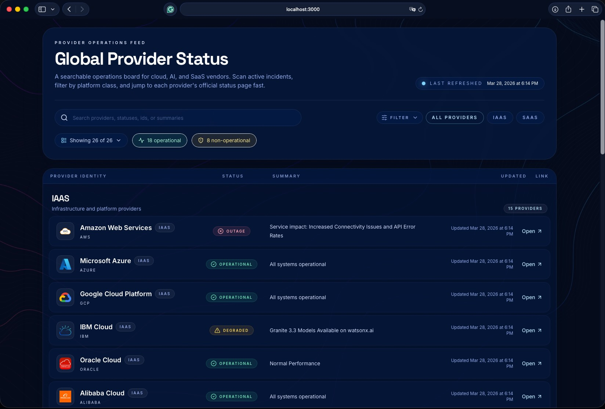

# Cloud Status Dashboard

[](https://nextjs.org/)
[](https://hub.docker.com/repository/docker/dmitryporotnikov/status-dashboard)
[](lib/status/providers)
[](https://github.com/dmitryporotnikov/cloud-status-dashboard/actions/workflows/docker-publish.yml)

One page that answers "is anything broken right now" across 27 providers. The server fetches their status pages every five minutes, normalizes the different formats into one model, and renders the result as two groups of cards, infrastructure and SaaS.

Your browser only talks to your own deployment. Provider requests happen server-side, so a busy team doesn't burn through someone else's rate limit.



## Providers

Infrastructure: AWS, Microsoft Azure, Google Cloud Platform, IBM Cloud, Oracle Cloud, Alibaba Cloud, DigitalOcean, Cloudflare, OVHcloud, Vultr, Linode, Akamai, Vercel, Heroku, MongoDB Cloud, UpCloud.

SaaS: GitHub, GitLab, Atlassian, Datadog, Twilio, Slack, Splunk Cloud Platform, Salesforce, Claude, Gemini, OpenAI.

## Run it locally

```bash
npm install
npm run dev
```

Open http://localhost:3000.

## Production build

```bash
npm run build
npm run start
```

## Docker

The image is on Docker Hub as `dmitryporotnikov/status-dashboard`.

```bash
docker pull dmitryporotnikov/status-dashboard
docker run --rm -p 3000:3000 --name status-dashboard dmitryporotnikov/status-dashboard
```

To build it yourself, the repo has a multi-stage Dockerfile and a standalone Next.js config:

```bash
docker build -t status-dashboard:latest .
docker run --rm -p 3000:3000 status-dashboard:latest
```

Then open http://localhost:3000. Pushes to `main` rebuild the published image through the workflow above.
